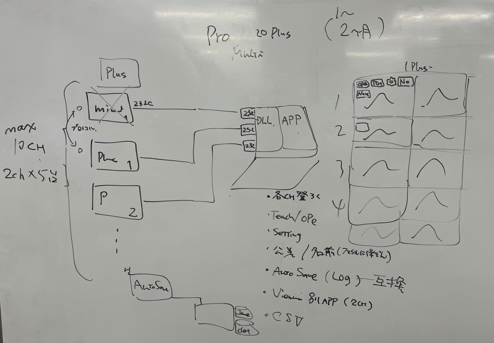

# 🗓 作業履歴メモ

## 📅 日付
- 2026-09-10（木）

---

## ✅ TODO
1. CFMSOLMini
   1. CPK表示
   - [ ] 

2. CFMLITE+
   - [x] FW SOCKET通信
      	- [x] タイトル画面にIP/MAC/PORT/SUBNET MASKを表示する
      	- [x] SOCKET SERVERとして動作させる
   - [x] DLL+ 作成
        - [x] Socket/Serial切替え
        - [x] サンプルアプリ作成
   - [ ] PRO-LITE+
        - [ ] DLL+を使用した通信に変更
        - [ ] Socket/Serial切替え
        - [ ] 複数台登録

3. SOL20Plus
   - [ ] Nand Flashにエラーログを書き出す際の不具合修正
   - [ ] 動作確認

4. Pro-MLT20Plus
   1. 構成案図
   2.  ()
   - [ ] 最大5台のTHB20Plusを接続する
   - [ ] 各chに以下を登録する
     - [ ] NO
     - [ ] COMポート番号
     - [ ] 機器名称
   - [ ] 各FWに対し以下が個別に実行出来ること
     - [ ] TEACH
     - [ ] OPE
     - [ ] RESET
     - [ ] SETTING読書
     - [ ] 自動保存
   - [ ] ビュアー別App
     - [ ] ログを閲覧
     - [ ] CSVコンバート

5. EFMSR-FW
   - [ ] AI学習回数とピーク更新回数の早い方がTEACH完了下段階で判定
   - [ ] ピーク基準２を作る（ピーク始角％とピーク終点％から始角・終角を確定して判定する）
   - [x] ティーチリセットタイマ（学習リセットタイマ）がかかるとREV判定がぬけて不具合が発生する

6. EFMSR-PC
   - [ ] 1000spmでsocket受信してログ保存、一定周期で表示更新
   - [ ] 各ツール結果表示
   - [ ] 各ツール傾向表示
   - [ ] 総合判定表示
   - [ ] その他情報表示（WORK番号、波形長、SPM、総数、OK数、NG数）
   - [ ] 通信設定（USBシリアル通信 or ETHERNET通信）
   - [ ] スケール設定にメモリ機能を追加
   - [ ] USB通信選択時に500spm以上になったときには通信を遮断する（処理が間に合っていない）

7. TS-DCA01の残件　4/03まで
   1. 修正が必要な残件
      - [ ] 波形時間がチラつく
      - [ ] LAN設定にMACアドレスを表示する機能が必要
      - [ ] RS485時に終端抵抗をオンオフする機能を追加
      - [ ] RS485時にCH1/CH2を設定し、表示する機能を追加
      - [ ] SAMPLE HOLD信号での判定の確認
      - [ ] OUT信号の確認
      - [ ] フロントSWの誤操作防止機能追加
      - [ ] チャージアンプリセットをドンとやらずに細かくやったら、電圧漏れが解消するか試したい
      - [ ] OK信号論理設定はOKだけでなく、HH/LL/H/Lもまとめて変更できたほうが良いのではないか？
      - [ ] チャージアンプ基板IDにより、種別表示を行う
      - [ ] 信号＋荷重トリガで荷重まちのときの中断ができない。（フロントSWで中断すること）
      - [ ] RS485で送信・受信でLEDつけたい（ポート番号おしえてもらう：送信赤:PE5、受信青:PE4、緑は予備:PE6）
      - [x] SCFの微調整を行う
      - [x] TEL用USB232のTEXT周期送信
      - [x] TOYOPUCプロトコルも実装
   2. テスト仕様書
      - [x] 作成
      - [ ] 実施
   3. TOYOTA用アンプ（5/31）
      - [x] TOYOPUCコンピュータリンク設定
      - [x] TOYOPUCコンピュータリンクプロトコル暫定実装
      - [ ] 通信仕様書作成

8. EFM-X2の残件（4/末）　優先順位★高●中▲低
   1. ★Ｘ傾きツール
      1. X傾きツールがおかしい
      2. X傾きツールがエンコーダ時に傾き線が正しく表示されない
   2. ▲初期化
      1. 設定初期化でフリーズすることがある（再現条件不明）
   3. ●追従時のＸ傾き・Ｙ傾き
      1. 測定枠追従のＸ傾き（表示が追従されていない？、判定は追従されている？）
      2. 測定枠追従のＹ傾き（追従不可にしたほうがよいかも）
   4. ★Ｙ傾きツール
      1. Ｙ傾き編集時に傾き線が表示されないことがある不具合（始点位置を少し変えると表示されるようになる。判定は正しくされる）
      2. Ｙ傾きが、同じところにおいているＸ傾きと100倍くらい違う
      3. エンコーダのときの、Ｙ傾き編集の傾き線が正しい位置に表示されない
      4. Ｙ傾きで追従すると公差範囲なのにNGになる
      5. 信号＋荷重に変更するとＹツールの線が変な所に表示される
   5. ●位置に関する不具合
      1. 開始位置、終了位置は少数第一位固定。その他の設定は長短モードに連動して整数と少数第一位になる。統一したい。
      2. スケールX軸が位置の場合、最大値6553.5を1500.0 or 15000に変更する
      3. スケールX軸が位置の場合、最小値を0以外に設定するとグラフがおかしい(破壊)
      4. 測定終了条件の位置の最大値が6553.5を1500.0 or 15000に変更する
      5. 開始位置から終了位置のグラフ表示が０スタートになっている。開始位置スタートにしたい。
      6. 開始位置と終了位置が同じ値を入力できなくする
      7. エンコーダ設定画面の位置換算カウンタ値の上限を切り良い数字にしてほしい（50000）
      8. エンコーダ設定のクリア方法の"Z信号によるクリア"が実装されてなければ、一旦削除したい
      9. 開始条件異chのデフォルトが0.0になっている。入力範囲が0.1なので、初期値は0.1
   6. ●グラフ表示
      1. X軸の０の位置が右詰めになっているので、左詰めにしてほしい
      2. 追従が有効中だとカーソルが機能しない
   7. ▲測定条件編集画面
      1. ツール選択時、すべてがツール１に飛ぶのではなく、左からツール１～ツール４に飛んでほしい。✕ボタンで測定条件設定に飛んでほしい
   8. ▲設定切替
      1. アナログ極性切替→センサ出力極性
   9. ●校正画面
      1. 編集ボタンを初期状態で表示するようにしてほしい
      2. 編集ボタンから入ったセンサ設定画面で✕を押すと校正データ設定画面に戻ってほしい
   10. ★測定開始／終了条件の組合せによる不具合
      1. 信号位置＋終了条件なんでも→で開始すると、開始条件成立してないのに永遠に動いている
      2. 信号位置＋終了条件荷重→一度取り込めたが、２度目は空データを取り込んで正しく判定しない
      3. 信号＋終了条件荷重→測定枠追従を行うと終了条件で設定した荷重が無効化される
      4. 信号荷重＋信号→マイナススタートで超えないと波形が破壊される？
      5. 信号荷重＋荷重→挙動が非常に不安定
   11. ▲USB設定
      1. カンマ形式でホールド値とグラフでログ出力すると、512点データがAD値になっている。→設定されている単位系にしたい
   12. ▲EFMX2PC V1.0.2.5
      1. タイトルバージョンがV1.0.2.4？
      2. CSVで出力したときの波形データ(512p)以降のヘッダがない（？？？）
      3. 荷重値表示が特定のウィンドウサイズ以下になるとズレてしまう。
   13. ●USBパラメータセーブ・ロード
      1. パラメータをセーブしてロードすると、等価入力校正しても初期値に戻ってしまう。

---

## 🧩 作業内容
1. PRO-MLT20Plus 仕様まとめ		7.0H
   - 開発環境: Visual Studio 2015
   - 画面: PRO-SOL20Plus-THB（OPE画面/設定画面）をベースに流用
   - 通信: SOL20THB_DLL を使用してCFM-THB20Plusを制御
   - 接続台数: CFM-THB20Plusを最大5台まで接続可能
   - 設定保存: system.ini に [CFM1]～[CFM5] セクションでPORT/NAMEを保存
     ```
     [CFM1]
     PORT=COM1
     NAME=１号機
     ：
     [CFM5]
     PORT=COM5
     NAME=５号機
     ```
   - 各機器設定画面でsystem.iniを読書
   - 各機器波形画面にCH1/CH2波形を表示
   - 各機器で個別に実行可能な操作
     - TEACHボタン
     - OPEボタン
     - RESETボタン
     - SETTINGボタン
     - 接続・切断ボタン
     - ログ自動保存
2. SOL20THB_DLL			1.5H
   1. 複数インスタンスに対応すべく修正
      1. _manualEventをSharedにしなくする
      2. 通信ログファイルをCOMポート毎に保存する
3. 

---

## 🧠 気づき・問題点
- PRO-MLT20Plusは機器（CFM-THB20Plus）ごとにワーカースレッドを1本立て、DLL経由で最大5台へ並行接続・制御する構成で実現可能。
  - 前提：SOL20THB_DLLがハンドル単位でインスタンス分離できること（グローバル静的状態を共有していないこと）を要確認。
  - UI更新は各スレッドから直接行わず、UIスレッドへメッセージ/イベントでマーシャリングする。
  - TEACH/OPE/RESET/SETTING/接続切断/ログ保存は機器ごとに独立したコマンドキューで処理し、1台の処理待ちが他機に影響しないようにする。

---

## 🛠 対応・検討メモ・予定
- 2026/8/31(月)0900- QT-D1の試作機完成
- 2026/9/07(月)1400- ハーネスMT
- SOL20THB_DLLがマルチインスタンス（ハンドルベース）対応かを確認し、非対応なら先にDLL改修が必要

---

## 📎 参考資料・リンク
- 
